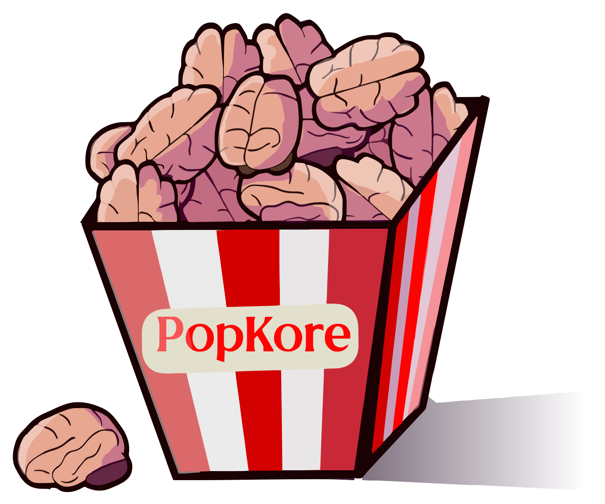
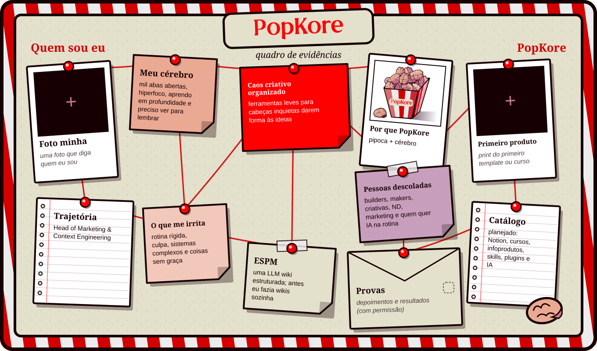

<p align="center">
  
</p>

<h1 align="center">PopKore</h1>

<p align="center">
  <strong>Pipoca para o seu cérebro. Resultados em porções rápidas e gostosas.</strong>
</p>

<p align="center">
  
  
  
</p>

---

## O que é a PopKore

**Caos criativo organizado.** A PopKore transforma conhecimento (IA, ferramentas e métodos)
em porções rápidas, para cabeças criativas tirarem ideias do papel sem apagar o que elas têm
de caótico.

- **Para quem:** pessoas criativas, neurodivergentes ou neurotípicas. Ninguém precisa de
  diagnóstico para ter mil abas abertas.
- **O problema:** IA confusa. Muito jargão, muito hype e pouca gente explicando do jeito de
  quem cria.
- **O jeito PopKore:** objetivos claros, passos bem estruturados e resultado rápido. Com
  estética pop, porque cérebro também gosta de pipoca.

A PopKore é um projeto antigo que está ganhando forma agora, durante um curso na ESPM.

## O que é este repositório

Esta é a **LLM wiki da PopKore**: a base de conhecimento da marca, escrita em Markdown e
versionada no Git. Ela serve a duas leitoras ao mesmo tempo: a fundadora, para pensar e
decidir, e os **agentes de IA** (Claude, ChatGPT, Gemini e outros), que usam a base como
contexto para criar com a voz da marca.

Aqui não tem produto à venda ainda. Tem a fundação: tese, posicionamento, voz, identidade
visual e as evidências de quem faz.

## Por onde começar

| Quero... | Leia |
| --- | --- |
| entender a marca em 5 minutos | [Tese](docs/01-base/01_tese.md) e [Posicionamento](docs/02-conteudo/marca/01_posicionamento.md) |
| escrever como a PopKore | [Voz e tom](docs/02-conteudo/marca/02_voz-e-tom.md) |
| usar a logo, as cores e as fontes | [Identidade visual](docs/02-conteudo/marca/03_identidade-visual.md) |
| saber em que pé está tudo | [STATE.md](STATE.md) |
| navegar a base inteira | [Mapa](docs/01-base/00_mapa.md) |
| trabalhar aqui como agente de IA | [AGENTS.md](AGENTS.md) |

## Quadro de evidências

Quem é a fundadora, o que é a PopKore e como uma coisa leva à outra, com fio vermelho:

<p align="center">
  <a href="docs/02-conteudo/marca/04_quadro-de-evidencias.md"></a>
</p>

## Quem faz


**Kell Bonassoli**, Head of Marketing & Context Engineering. Cérebro neurodivergente, mil abas
abertas e prática real com IA no dia a dia. Também pesquisa
[Context Engineering for Marketing](https://github.com/eusouakell/context-engineering-for-marketing)
e escreve a newsletter [Cereja Flamejante](https://cerejaflamejante.substack.com/).

<br clear="left">

[](https://www.linkedin.com/showcase/popkore/)
[](https://www.linkedin.com/in/eusouakell/)
[](https://www.instagram.com/eusouakell/)
[](https://eusouakell.com.br/)

## Como a base funciona

```text
docs/
  01-base/          tese, léxico, entidades
  02-conteudo/      marca/, produtos/, publico/, conteudo-e-canais/
  09-operacao/      schema, camadas, ingestão, colaboração com modelos
views/              trilhas de leitura (fundadora, agentes)
projeto/            inbox → nota → decisão → backlog → log → handoff
scripts/            auditoria da base e gerador do quadro de evidências
STATE.md            estado atual, próximo passo e riscos
AGENTS.md           regras para agentes de IA
```

- **Commit direto na `main`**, depois de rodar `python scripts/audit-kb.py` e revisar o diff.
- **Este repositório é público.** Nunca entram aqui: senhas e chaves, dados financeiros e
  preços, dados de clientes, ou qualquer coisa que viole a LGPD ou a GDPR. Veja a
  [política de segurança](.github/SECURITY.md).
- Toda nota tem frontmatter rico ([schema](docs/09-operacao/00_schema.md)).

<sub>Feito a partir da [knowledge-base-seed](https://github.com/wagnerlsmartins/knowledge-base-seed). Logo, foto e avatar são da PopKore e da Kell Bonassoli: não reutilize sem autorização.</sub>

<p align="center">🍿</p>
