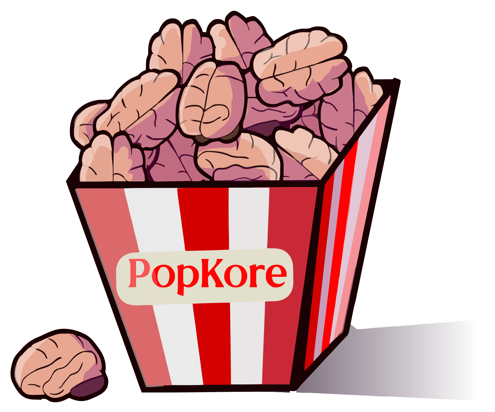
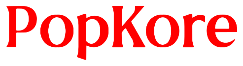

# Identidade visual

> Logo, cores e regras de uso. A paleta foi medida nos pixels da logo. A **tipografia** é uma
> proposta, a confirmar pela fundadora.

## Logo

Um balde de pipoca listrado de vermelho e branco, cheio de **cérebros no lugar da pipoca**,
com um cérebro caído ao lado. No centro do balde, uma etiqueta creme com o nome "PopKore" em
vermelho.

## O que a logo comunica

- **Pop + Kore:** a pipoca (cultura pop, entretenimento, cinema) encontra o cérebro (o
  *core*, a mente). É a tese em imagem: cabeças criativas tratadas com leveza e diversão.
- **Cérebros transbordando:** o caos criativo, ideias demais para caber no balde.
- **O cérebro caído:** imperfeição assumida; nem tudo cabe na caixa, e tudo bem.
- **Traço de cartoon com contorno grosso:** tom informal, divertido, nada corporativo.

## Nome (versão só com o nome)

O lettering da etiqueta, recortado e vetorizado. Use quando a logo completa não couber:
cabeçalhos, rodapés, assinaturas de e-mail, capas de template e espaços horizontais.

## Paleta

Cores medidas nos pixels da logo:

| Nome | Hex | Onde aparece | Papel |
| --- | --- | --- | --- |
| Vermelho pipoca | `#D40000` | listras do balde | cor principal |
| Vermelho pop | `#FF0000` | o nome "PopKore", listras laterais | destaque, CTA, nome |
| Creme etiqueta | `#E3E0CC` | etiqueta do nome | fundo de marca |
| Branco listra | `#ECECEC` | listras do balde | fundo neutro |
| Pêssego cérebro | `#EAA993` | cérebros (luz) | apoio |
| Rosa cérebro | `#F2C8BA` | cérebros (brilho) | apoio claro |
| Malva cérebro | `#CB788D` | cérebros (sombra) | apoio |
| Lilás | `#C79FBC` | reflexo na lateral | apoio |
| Contorno | `#170003` | traços e contornos | texto e linhas |

O vermelho `#FF0000` sobre creme `#E3E0CC` tem contraste baixo para texto corrido (3:1; sobre
branco, 4:1). Use essa dupla só no nome e em títulos grandes. Para texto corrido, prefira
`#170003` sobre creme ou sobre branco.

## Tipografia (proposta)

| Uso | Fonte | Por quê |
| --- | --- | --- |
| Títulos | [Marcellus](https://fonts.google.com/specimen/Marcellus) | serifa "flare" como o lettering do nome; conversa com a logo sem copiá-la |
| Texto | [Atkinson Hyperlegible](https://fonts.google.com/specimen/Atkinson+Hyperlegible) | feita para máxima legibilidade, coerente com uma marca feita por e para pessoas neurodivergentes |

As duas são gratuitas (Google Fonts) e funcionam no Notion via importação ou em imagens. O
nome "PopKore" **não** é escrito com fonte: use sempre o arquivo do nome.

## Regras de uso

- **Área de proteção:** deixe em volta da logo e do nome um espaço livre igual à altura da
  letra "o" do nome.
- **Tamanho mínimo:** logo completa com 120 px (ou 25 mm) de largura; nome com 80 px (ou
  15 mm).
- **Fundos permitidos:**
  - logo completa: branco, creme `#E3E0CC` ou fotos claras e pouco poluídas;
  - nome vermelho: branco ou creme;
  - nome branco: contorno `#170003`, vermelho `#D40000` ou fotos escuras;
  - nome escuro: qualquer fundo claro em que o vermelho não funcione.
- **Não faça:** distorcer ou girar a logo, trocar as cores dos cérebros ou do balde, aplicar
  sombra ou contorno extras, colocar a logo completa sobre fundo vermelho ou estampado, ou
  reescrever o nome com outra fonte.

## Arquivos

| Arquivo | Uso |
| --- | --- |
| [`assets/popkore-logo.svg`](assets/popkore-logo.svg) | **padrão:** vetor, 200 KB, escala sem perder qualidade |
| [`assets/popkore-logo.png`](assets/popkore-logo.png) | raster com fundo transparente, 1753×1582 px |
| [`assets/popkore-logo.jpg`](assets/popkore-logo.jpg) | onde PNG não é aceito (fundo branco) |
| [`assets/popkore-nome-vermelho.svg`](assets/popkore-nome-vermelho.svg) | nome em `#FF0000`, para fundos claros |
| [`assets/popkore-nome-branco.svg`](assets/popkore-nome-branco.svg) | nome em branco, para fundos escuros |
| [`assets/popkore-nome-escuro.svg`](assets/popkore-nome-escuro.svg) | nome em `#170003`, monocromático |

Os SVGs foram gerados por vetorização automática (vtracer) a partir do PNG. São fiéis à
logo, mas não substituem um vetor desenhado à mão: os traços podem ter pequenas
irregularidades em tamanhos muito grandes, como banners e impressão.

O arquivo-fonte original `PopKore.svg` (Inkscape, 23 MB) **não está no Git**: ele guarda 32
imagens PNG embutidas. Guarde-o fora do repositório.

## Pendências

- [x] vetorizar a logo (SVG só com paths)
- [x] versão só com o nome, para cabeçalhos e espaços pequenos
- [x] medir a paleta exata
- [x] regras de uso: área de proteção, tamanho mínimo, fundos permitidos
- [ ] confirmar a tipografia proposta
- [ ] para impressão grande: redesenhar a logo à mão em vetor (designer ou Inkscape)
