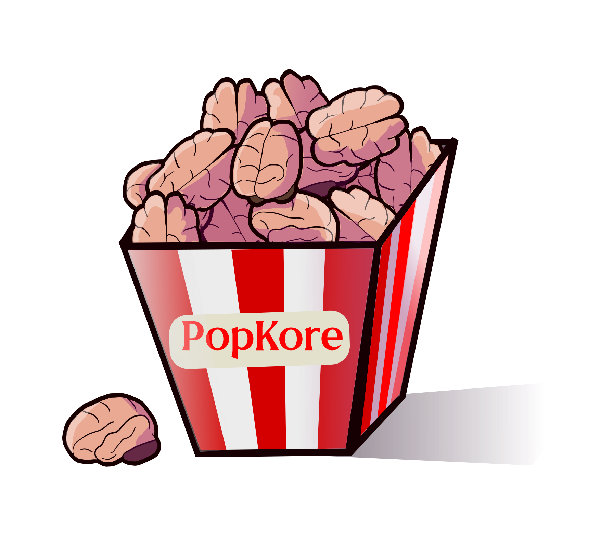

# Identidade visual

> Hoje a logo é o único asset da marca. Paleta, tipografia e regras de uso abaixo são
> leituras da logo, ainda não decisões formais.

## Logo

Um balde de pipoca listrado de vermelho e branco, cheio de **cérebros no lugar da pipoca**,
com um cérebro caído ao lado. No centro do balde, uma etiqueta creme com o nome "PopKore" em
vermelho.

## O que a logo comunica

- **Pop + Kore:** a pipoca (cultura pop, entretenimento, cinema) encontra o cérebro (o
  *core*, a mente). É a tese em imagem: cabeças criativas tratadas com leveza e diversão.
- **Cérebros transbordando:** o caos criativo, ideias demais para caber no balde.
- **O cérebro caído:** imperfeição assumida; nem tudo cabe na caixa, e tudo bem.
- **Traço de cartoon com contorno grosso:** tom informal, divertido, nada corporativo.

## Paleta observada na logo

Valores aproximados, a confirmar com o arquivo-fonte:

| Cor | Onde aparece | Aproximação |
| --- | --- | --- |
| Vermelho vivo | listras e nome | ~ `#D40000` |
| Branco / cinza claro | listras | ~ `#ECECEC` |
| Creme | etiqueta do nome | ~ `#E5E0CC` |
| Rosa-pêssego | cérebros (luz) | ~ `#EBAA94` |
| Rosa-malva | cérebros (sombra) | ~ `#C87088` |
| Marrom quase preto | contornos | ~ `#1A0004` |

## Arquivos

| Arquivo | Uso |
| --- | --- |
| [`assets/popkore-logo.png`](assets/popkore-logo.png) | padrão: fundo transparente, 1753×1582 px |
| [`assets/popkore-logo.jpg`](assets/popkore-logo.jpg) | onde PNG não é aceito (fundo branco) |

O arquivo-fonte `PopKore.svg` (Inkscape, 23 MB) **não está no Git**: apesar de ser SVG, ele
guarda 32 imagens PNG embutidas, então é pesado e não escala como vetor de verdade. Guarde-o
fora do repositório.

## Pendências

- [ ] vetorizar a logo de verdade (SVG só com paths) para ter arquivo leve e escalável
- [ ] versão horizontal ou só o nome, para cabeçalhos e espaços pequenos
- [ ] confirmar a paleta e escolher tipografias
- [ ] regras de uso: área de proteção, tamanho mínimo, fundos permitidos
