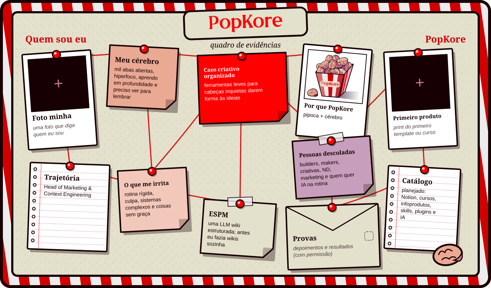

# Quadro de evidências

Um quadro de detetive, com fio vermelho, para juntar as **evidências** de quem é a fundadora e
do que é a PopKore. Cada espaço é uma pergunta. Quando houver material suficiente, os fios
mostram como a história da fundadora sustenta a marca.

## Espaços

| Espaço | Lado | Pergunta | Estado | Evidência |
| --- | --- | --- | --- | --- |
| Foto minha | Quem sou eu | uma foto que diga quem eu sou | vazio | |
| Meu cérebro | Quem sou eu | como minha cabeça funciona, em 1ª pessoa | preenchido | Preciso aprender em profundidade, tenho mil abas abertas, começo tudo e termino pouco, entro em hiperfoco e preciso ver para lembrar. (fundadora, 2026-11-19) |
| Trajetória | Quem sou eu | de onde eu vim e o que me trouxe até aqui | preenchido | Head of Marketing & Context Engineering. (fundadora, 2026-11-19) |
| O que me irrita | Quem sou eu | o que me incomoda na produtividade tradicional | preenchido | Coisas chatas e sem graça, rotina rígida, culpa e disciplina, sistemas complexos demais e tudo feito para cérebros típicos. (fundadora, 2026-11-19) |
| ESPM | Quem sou eu | o que o curso me deu para a marca | preenchido | Já tinha wikis próprias, feitas de forma autodidata; no curso está experimentando esta LLM wiki, um repositório estruturado por outra pessoa. (fundadora, 2026-11-19) |
| Caos criativo organizado | PopKore | a tese em uma frase | preenchido | [tese](../../01-base/01_tese.md) |
| Por que PopKore | PopKore | de onde vem o nome | preenchido | [logo e nome](03_identidade-visual.md) |
| Pessoas descoladas | PopKore | quem é, o que sente, como fala | preenchido | Builders, makers e empreendedoras; criativas e freelancers; pessoas neurodivergentes; estudantes e jovens profissionais; profissionais de marketing; pessoas que querem trazer IA para a rotina. (fundadora, 2026-11-19) |
| Primeiro produto | PopKore | print do primeiro template ou curso | vazio | Ainda não existe (2026-11-19). |
| Catálogo | PopKore | templates, cursos rápidos, infoprodutos | preenchido (planejado) | Linhas planejadas, nenhuma lançada: templates de Notion, cursos rápidos, infoprodutos, skills, plugins e artefatos, IA na rotina. (fundadora, 2026-11-19) |
| Provas | PopKore | depoimentos e resultados | vazio | |

**Cobertura atual: 8 de 11.** Faltam: Foto minha, Primeiro produto e Provas.

## Fios (ligações)

As ligações dizem que história o quadro conta:

- **Foto → Meu cérebro → Caos criativo organizado:** a vivência da fundadora é a origem da tese.
- **O que me irrita → Caos criativo organizado:** a tese nasce contra a produtividade engessada.
- **Trajetória → ESPM → Caos criativo organizado:** a formação dá forma à marca.
- **Caos criativo organizado → Por que PopKore:** o nome e a logo traduzem a tese.
- **Caos criativo organizado → Pessoas descoladas → Primeiro produto → Catálogo:** da tese
  ao que se vende.
- **Pessoas descoladas e Catálogo → Provas:** quem comprou confirma a promessa.

## Regras

- **Privacidade:** depoimentos só com permissão por escrito, e sem dados pessoais de
  clientes (LGPD/GDPR). Fotos de terceiros não entram.
- Evidência é **fonte**, não conclusão: quando um espaço for preenchido, registre de onde veio
  (nota, post, print, conversa).
- Fotos e prints ficam em `assets/quadro/`.

## Como atualizar o quadro

1. Preencha a linha do espaço na tabela acima.
2. Em [`scripts/gerar-quadro-evidencias.py`](../../../scripts/gerar-quadro-evidencias.py),
   troque o texto do espaço e marque `preenchido` como `True`.
3. Rode `python scripts/gerar-quadro-evidencias.py` para redesenhar o SVG.

Ou peça a um agente: "preencha o espaço Meu cérebro do quadro de evidências com…".
